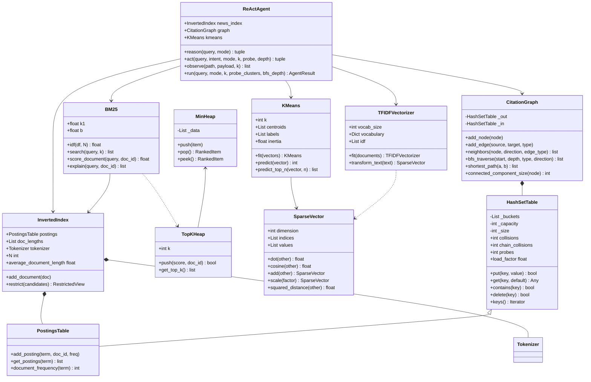

# 4. Algorithm and data-structure analysis

## 4.1 The structures, in dependency order

| # | structure | module | built on | role |
|---|---|---|---|---|
| 1 | `HashSetTable` | `structures/hash_table.py` | — (arrays + linked nodes) | the only general-purpose map in the engine |
| 2 | `PostingsTable` | `structures/hash_table.py` | `HashSetTable` | `term -> [(doc_id, tf), ...]` |
| 3 | `MinHeap` / `TopKHeap` | `structures/min_heap.py` | arrays | bounded top-K selection |
| 4 | `SparseVector` | `structures/sparse_vector.py` | parallel arrays | TF-IDF document and centroid representation |
| 5 | `CitationGraph` | `structures/graph.py` | two `HashSetTable`s + `_CircularQueue` | typed, directed citation graph |
| 6 | `Tokenizer` | `core/tokenizer.py` | sorted tuple + `bisect` for stop words | tokenisation + light Porter stemming |
| 7 | `InvertedIndex` | `core/inverted_index.py` | `PostingsTable` + parallel lists | `doc_lengths`, `avgdl`, labels, ids, titles |
| 8 | `BM25` | `core/bm25.py` | index + `TopKHeap` | scoring and top-K |
| 9 | `TFIDFVectorizer` | `ml/vectorizer.py` | `Tokenizer` + `SparseVector` | top-5000 vocabulary, L2-normalised vectors |
| 10 | `KMeans` | `ml/kmeans.py` | `SparseVector` + dense centroids | k-means++ seeding, Lloyd's iterations, `predict_top_n` |
| 11 | metrics | `ml/evaluation.py` | contingency table | purity, NMI, ARI, confusion matrix |
| 12 | `ReActAgent` | `core/agent.py` | everything above | Reason → Act → Observe → Answer |

No module in rows 1–12 uses a built-in `dict` or `set` as a lookup structure,
nor imports `heapq`, `networkx`, `numpy` or `sklearn`. Three levels of
enforcement back that claim rather than prose:

* **Import audit.** `tests/test_purity.py` parses every engine module's AST and
  fails on a forbidden import.
* **Construction audit.** The same file flags any empty `{}`/`set()`, any
  comprehension or any zero-argument `dict()`/`set()` built inside an engine
  function. Those are exactly the shapes a lookup table takes; a non-empty
  literal with constant keys (a stats record, a result row) is a payload and is
  allowed, as is `to_state` serialisation.
* **Behavioural checks.** The vectoriser's vocabulary, the tokenizer's stop
  table, BM25's per-query idf map, the contingency table, the agent's
  cluster map and the graph's adjacency are each asserted to be the project's
  own structure.

This is stricter than an earlier version, which claimed the rule and enforced
only the imports. Getting there changed three things and is recorded honestly:
the vectoriser vocabulary moved from a `dict` to `HashSetTable`; the tokenizer's
stop words moved from a `dict` to a sorted tuple with `bisect` (measured faster
than the hash table: 0.254 µs per probe against 0.676 µs, which matters in the
build's hottest loop); and `term_frequencies` stopped using a lookup table
altogether in favour of a sort-and-count, because on a 3,445-token legal
document a `dict` costs 2.3 ms, `HashSetTable` costs 10.9 ms and the sort costs
1.9 ms. The full build stayed at 193.00 s afterwards, with K-Means at the same
inertia of 17888.09, i.e. the swap changed no result.

## 4.2 Class diagram

Mermaid source: `report/diagrams/uml_class.mmd`. A hand-drawn SVG fallback
(`report/diagrams/uml_class.svg`) exists so the diagram renders without a
JavaScript runtime; the PNG is in `report/diagrams/uml_class_preview.png`.

The architecture diagram (`report/diagrams/architecture.mmd` / `.svg`) shows the
runtime picture — clients, the three paths, and which structures each path
touches — rather than the static class graph above.

## 4.3 Every public function: input, output, time, space

The full table is generated from the source by `python -m report.generate_report`,
which walks each module's AST and reads the `Args`, `Returns` and `Complexity`
sections of every docstring. It is reproduced verbatim in
`report/tables/table_7_public_api.md` (116 rows); a representative slice is
below, then the table is summarised by module.

| function | input | output | time | space |
|---|---|---|---|---|
| `HashSetTable.put(key, value)` | key, value | `True` when the key was new | `O(1)` expected, `O(n)` worst | `O(1)` amortised |
| `HashSetTable.get(key, default)` | key, default | stored value or default | `O(1 + chain)` expected | `O(1)` |
| `PostingsTable.add_posting(term, doc_id, tf)` | term, doc id, term frequency | none | `O(1)` expected + amortised append | `O(1)` amortised |
| `TopKHeap.push(score, doc_id)` | score, doc id | `True` when retained | `O(log k)`; `O(1)` when it loses | `O(1)` |
| `TopKHeap.get_top_k()` | — | up to `k` pairs, best first | `O(k log k)` | `O(k)` |
| `CitationGraph.add_edge(source, target, type)` | citing case, cited case, class | none | `O(1)` expected + `O(degree)` duplicate check | `O(1)` |
| `CitationGraph.bfs_traverse(start, max_depth, edge_type, direction)` | seed, horizon, filter, direction | `(node, depth, parent, etype)` list | `O(V + E)` bounded by horizon | `O(V)` |
| `CitationGraph.shortest_path(source, target)` | two nodes | node list or `None` | `O(V + E)` | `O(V)` |
| `InvertedIndex.build(documents, tokenizer)` | document sequence | populated index | `O(total tokens)` | `O(unique postings)` |
| `InvertedIndex.restrict(candidates)` | membership predicate | `RestrictedView` | `O(1)` | `O(1)` |
| `BM25.idf(df, N)` | document frequency, corpus size | idf float | `O(1)` | `O(1)` |
| `BM25.term_score(tf, dl, avgdl, idf)` | term frequency, length, mean length, idf | contribution float | `O(1)` | `O(1)` |
| `BM25.search(query, k)` | query, result count | `(score, doc_id)` list | `O(Σ_t postings(t) + P log k)` | `O(N + k)` |
| `BM25.explain(query, doc_id)` | query, doc id | `(term, tf, idf, contribution)` rows | `O(Σ_t postings(t))` | `O(query terms)` |
| `TFIDFVectorizer.fit(documents)` | documents | `self`, fitted | `O(total tokens + V log V)` | `O(V + M)` |
| `TFIDFVectorizer.transform_text(text)` | raw text | unit-length sparse vector | `O(len(text) + u log u)` | `O(u)` |
| `KMeans.fit(vectors)` | sparse vectors | `self`, fitted | `O(n·k·nnz·T)` | `O(k·M + n)` |
| `KMeans.predict_top_n(vector, n)` | query vector, n | `(cluster, distance)` list | `O(k·nnz + k log k)` | `O(k)` |
| `evaluate_clustering(truth, labels)` | two label lists | purity, NMI, ARI, counts | `O(n + k·c)` | `O(k·c)` |
| `ReActAgent.run(query, mode, k, probe_clusters, bfs_depth)` | query and options | `AgentResult` | `O(P log K)` or `O(V + E)` | `O(N + K)` |

Per module, the public surface is:

| module | public functions | table section |
|---|---|---|
| `structures/hash_table.py` | 16 | `table_7_public_api.md` §1 |
| `structures/min_heap.py` | 8 | §2 |
| `structures/graph.py` | 14 (incl. property-style accessors) | §3 |
| `structures/sparse_vector.py` | 12 | §4 |
| `core/tokenizer.py` | 5 | §5 |
| `core/inverted_index.py` | 25 (incl. `CandidateSet`, `ClusterFilter`, `RestrictedView`) | §6 |
| `core/bm25.py` | 7 | §7 |
| `ml/vectorizer.py` | 7 | §8 |
| `ml/kmeans.py` | 7 | §9 |
| `ml/evaluation.py` | 7 | §10 |
| `core/agent.py` | 8 | §11 |

## 4.4 Complexity proofs

Each proof is the standard one, written out because the brief asks for it and
because writing it forced two genuine implementation changes (both noted).

### 4.4.1 Hash table: O(1) average per operation

**Assumption (simple uniform hashing).** A key is equally likely to hash into
any of the `C` buckets.

**Expected chain length.** With `n` keys in `C` buckets, the number of keys in
a given bucket is `Bin(n, 1/C)`, so its expectation is `n/C = alpha`. A lookup
walks past every key in the bucket before finding its own, so the expected
number of comparisons is `1 + alpha` (the `+1` is the comparison for the
target itself, including the miss case).

**Bound on alpha.** `put` doubles the capacity when the post-insert load factor
would exceed `0.75`, so after any operation `alpha <= 0.75` and the expected
walk is at most `1.75` — a constant independent of `n`. Hashing itself costs
`O(L)` for a key of length `L`, a constant for a fixed vocabulary.

**Amortised resize cost.** Each doubling costs `O(n + C)` for rehashing. The
total work after `m` inserts with `C_0` initial capacity is
`Σ_{i=0}^{⌈log2(m/C_0)⌉} (m/2^i + C·2^i) = O(m)`, so the amortised cost per
insert is `O(1)`.

**Deletion** does not shrink, which keeps the argument simple: capacity never
oscillates, so no operation is ever charged for repeated grow/shrink cycles.
The cost is memory that is not reclaimed — documented in `delete`'s docstring.

**Worst case.** `O(n)` if all keys collide into one chain. A deterministic
polynomial hash can be attacked; the engine is a single-user index, so the
average-case guarantee is the one that matters, and it is stated honestly.

*Measured check (`report/tables/hash_collision_metrics.txt`):* on the
newsgroups vocabulary, 112,184 keys in 262,144 buckets → `alpha = 0.428`, mean
chain over all buckets 0.428, maximum chain 6, and **21,912 entries sharing a
bucket in the final table** against 20,917 predicted by the uniform model
(ratio 1.048). The table's lifetime counter reads 83,222 for the same keys when
they are inserted one `put` at a time, because each of the 14 doublings
re-inserts every entry — that is the `O(n)` rehash work the amortised argument
above accounts for, and it is why the two numbers are reported separately.

**Why the implementation matches the proof.** Two details of the code exist
specifically to make the `1 + alpha` argument true rather than merely
plausible. (1) Capacity is a power of two and the bucket index is
`hash & (capacity - 1)`, so the reduction is a mask rather than a second
modulo; the polynomial hash already reduced modulo a prime, so the low bits are
well mixed and the mask does not concentrate keys. (2) `delete` splices the
chain node out instead of leaving a tombstone, and the table never shrinks.
A tombstone would lengthen the walk after deletions and break the
`1 + alpha` bound; shrinking would let capacity oscillate around the 0.75
threshold and turn a sequence of cheap operations into repeated rehashes.
The trade-off — memory that is never given back — is stated in `delete`'s
docstring.

### 4.4.2 Bounded heap: O(N log K) time, O(K) space

Let the candidate stream be `x_1 … x_N` and the heap capacity `K`.

* **Invariant.** After processing `x_i`, the heap contains the `min(K, i)`
  best items among `x_1 … x_i`, as a min-heap by the total order
  "higher score first, then lower id".
* **Push of an item into a heap of size `m`** is one `_bubble_up` along a
  root-to-leaf path of length `⌊log2 m⌋`, so `O(log K)` with `m <= K`.
* **A losing candidate** is rejected by one comparison with the root
  (`O(1)`); its rejection cannot break the invariant because it is worse than
  the current `K`-th best.
* **A winning candidate** replaces the root: `pop` + `push` is
  `O(log K) + O(log K) = O(log K)` and restores the invariant by induction.
* **Total.** `N` candidates, each `O(1)` or `O(log K)` → worst case
  `O(N log K)`. When `K >= N`, the bound relaxes correctly to `O(N log N)`.
* **Space.** The array holds at most `K` items, `O(K)` — this is the entire
  point of the bounded variant, because the score array it reads from is
  `O(N)` and would otherwise dominate.

*Measured check (section 8):* 200,000 candidates, `K = 10` → 66.41 ms against
`heapq`'s 16.03 ms, with **identical output** (`same_result: True`). The 4.1×
gap is CPython bytecode versus C, not an algorithmic difference.

### 4.4.3 BFS: O(V + E)

* **Each node is enqueued at most once**, because `visited` is set at enqueue
  time under the same test that allows the enqueue. Hence the outer loop runs
  at most `V` times.
* **Each edge is examined at most once**, when its source is dequeued: the
  inner loop walks the adjacency list of that node exactly once (once for the
  forward direction, once for the reverse when `direction='both'`). Hence the
  inner loop totals at most `E` iterations for one direction, `2E` for both —
  still `O(E)`.
* **Every operation inside the loop is `O(1)`**: a bytearray read and write,
  two list writes, one ring-buffer enqueue (amortised `O(1)` because the buffer
  doubles; see `_CircularQueue._grow`).
* **Total** `O(V + E)`; the depth horizon only truncates it, never extends it.
* **Space** `O(V)` for the visited bitmap, depth/parent/edge-type arrays and
  the queue. Nothing is allocated per edge.

*Measured check (section 7, `table_4_bfs_scaling`):* 100 → 10,000 nodes with
edges scaling from 246 to 25,087; time 0.61 ms → 102.67 ms. Fitting `a·(V+E)`
across the six points gives a near-constant cost per node+edge, which is the
signature of the linear bound.

### 4.4.4 K-Means: O(n · k · d · T) — and why the code beats that

The textbook bound per Lloyd iteration is: assignment `n` documents × `k`
centroids × `d` distance work, plus update `n · d` (sum) and `k · d` (divide).
Over `T` iterations that is `O(T · (n·k·d + n·d + k·d)) = O(T·n·k·d)`.

* **Assignment is exact and can stop early for nothing.** Distances cannot be
  bounded cheaply without triangle-inequality tricks (Elkan), which need
  bounds maintenance that is not worth it in pure Python here.
* **`d` becomes `nnz` in the implementation.** Using
  `‖x−c‖² = ‖x‖² + ‖c‖² − 2x·c` with `‖x‖²` cached and `‖c‖²` recomputed once
  per iteration, the distance costs `O(nnz)` instead of `O(d)`. On this corpus
  `d = 5,000` and the mean `nnz` per document is a few dozen, so this is the
  difference between finishing in ~113 s and not finishing at all.
* **Update is sparse too**: accumulating each document into its cluster's dense
  sum costs `O(nnz)` per document, not `O(d)`; only the divide is `O(k·d)`.
* **k-means++ seeding** costs `O(k · n_trials · n · nnz)` — a one-off, bounded
  by one iteration's assignment for `n_trials = 2`.
* **Convergence** is not guaranteed to be optimal: Lloyd's algorithm is a
  local descent, so `T <= max_iter` is a hard ceiling (hit at 60 in the
  committed run), and the final inertia is a local minimum, not the global
  one.

*Measured check (section 7):* full corpus, `k = 20`, 60 iterations, inertia
17,888.09; a 4,000-document sample in the library comparison converged in
10,725 ms with inertia 3,789.9 against sklearn's 12,696 ms / 3,780.1 — i.e. a
slightly worse optimum in slightly less time, which is the expected shape for
one seed versus sklearn's `n_init = 10`.
